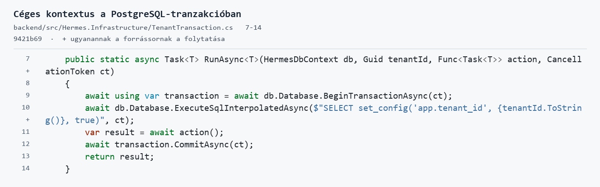

# Céges kontextus a PostgreSQL-tranzakcióban



**Forrás** [backend/src/Hermes.Infrastructure/TenantTransaction.cs, 7–14. sor](https://github.com/NemodaMark/Hermes_flotter/blob/9421b69278601c8b7e73d032f88858dbc0bb4f2e/backend/src/Hermes.Infrastructure/TenantTransaction.cs#L7-L14). **Azonosító** `TenantTransaction.RunAsync<T>`. **Javasolt fejezet** Céges adatelkülönítés.

**Működés.** Az EF Core-kontextust, a cég UUID-ját, a végrehajtandó műveletet és a megszakítási tokent kapja. Tranzakciót indít, beállítja a `app.tenant_id` változót, meghívja a műveletet, majd siker esetén véglegesít és visszaadja az eredményt.

**Kapcsolatok.** A `set_config` harmadik, `true` paramétere a tranzakció élettartamára korlátozza a beállítást. A `FleetManagement.Scoped` ezen belül ad jogot és zárolásokat a művelethez. Hibánál a tranzakció felszabadítása után elmarad a véglegesítés.

**Korlát.** A cégazonosító eredetének és a hozzáférésnek az ellenőrzése a hívó feladata. Az adatbázisoldali szűrést saját RLS-szabályok végzik.

**Kivágás.** A teljes metódus. A képen a `+` vizuális sortörést jelöl ugyanazon forrássoron belül.

```csharp
    public static async Task<T> RunAsync<T>(HermesDbContext db, Guid tenantId, Func<Task<T>> action, CancellationToken ct)
    {
        await using var transaction = await db.Database.BeginTransactionAsync(ct);
        await db.Database.ExecuteSqlInterpolatedAsync($"SELECT set_config('app.tenant_id', {tenantId.ToString()}, true)", ct);
        var result = await action();
        await transaction.CommitAsync(ct);
        return result;
    }
```

**A másolható részlet SHA-256 lenyomata** `2bced7ab9010204396b4e381199a783a51c06334970e7265e08d5b32c23369d6` (UTF-8, LF).
