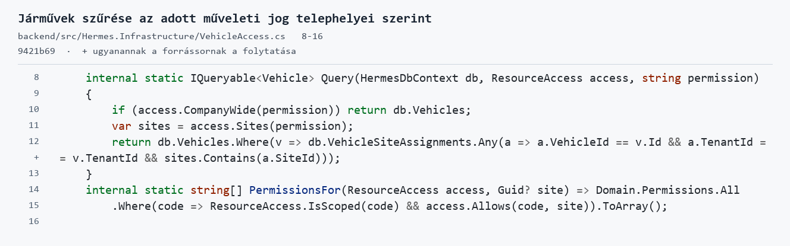

# Járművek szűrése az adott műveleti jog telephelyei szerint



**Forrás** [backend/src/Hermes.Infrastructure/VehicleAccess.cs, 8–16. sor](https://github.com/NemodaMark/Hermes_flotter/blob/9421b69278601c8b7e73d032f88858dbc0bb4f2e/backend/src/Hermes.Infrastructure/VehicleAccess.cs#L8-L16). **Azonosító** `VehicleAccess.Query és PermissionsFor`. **Javasolt fejezet** Céges adatelkülönítés.

**Működés.** A bemenet a céges kontextusban működő DB, az összesített `ResourceAccess` és a kért jogkód. Teljes céges jognál átadja a céges járműlekérdezést. Korlátozott jognál csak az adott kódhoz rendelt telephelyekhez kapcsolt járművek maradnak. A második metódus felsorolja a megadott helyen használható műveletkódokat.

**Kapcsolatok.** Az `Any` feltétel a jármű és a hozzárendelés cégazonosítóját is összeveti. A `FleetManagement.Car` ugyanezt az `IQueryable<Vehicle>`-t szűri közvetlen egyedi megnyitáskor.

**Korlát.** A metódus cég- és RLS-kontextust feltételez. Hely nélküli jármű korlátozott joggal kiesik, és a módosítás egyéb feltételeit a hívó ellenőrzi.

**Kivágás.** Két teljes metódus. A keresési és auditmetódus a részleten kívül marad. A képen a `+` vizuális sortörést jelöl ugyanazon forrássoron belül.

```csharp
    internal static IQueryable<Vehicle> Query(HermesDbContext db, ResourceAccess access, string permission)
    {
        if (access.CompanyWide(permission)) return db.Vehicles;
        var sites = access.Sites(permission);
        return db.Vehicles.Where(v => db.VehicleSiteAssignments.Any(a => a.VehicleId == v.Id && a.TenantId == v.TenantId && sites.Contains(a.SiteId)));
    }
    internal static string[] PermissionsFor(ResourceAccess access, Guid? site) => Domain.Permissions.All
        .Where(code => ResourceAccess.IsScoped(code) && access.Allows(code, site)).ToArray();

```

**A másolható részlet SHA-256 lenyomata** `1d6181ccbcc2ee00b872eb3b4af2518ded5d39720e470a2923ad4bf5d04e9306` (UTF-8, LF).
