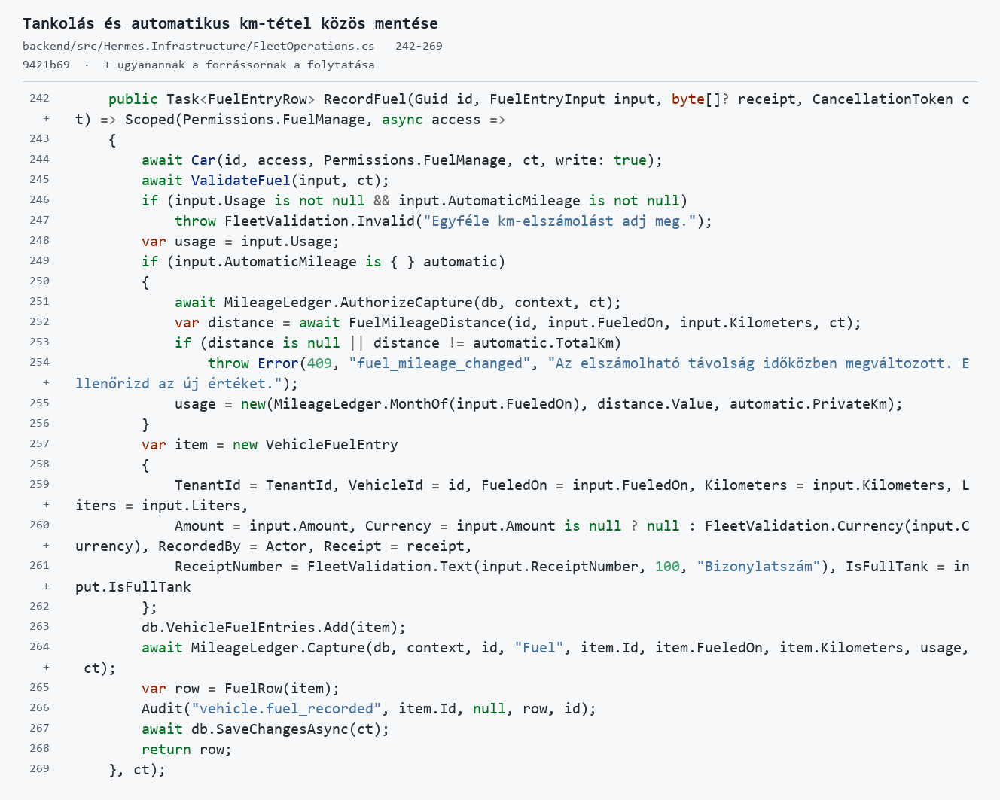

# Tankolás és automatikus km-tétel közös mentése



**Forrás** [backend/src/Hermes.Infrastructure/FleetOperations.cs, 242–269. sor](https://github.com/NemodaMark/Hermes_flotter/blob/9421b69278601c8b7e73d032f88858dbc0bb4f2e/backend/src/Hermes.Infrastructure/FleetOperations.cs#L242-L269). **Azonosító** `FleetManagement.RecordFuel`. **Javasolt fejezet** Tankolási munkafolyamat.

**Működés.** A művelet a jármű azonosítóját, a `FuelEntryInput` adatot és az opcionális kép bájtjait kapja. Jogosultság és validáció után eldönti, melyik km-beviteli mód aktív. Automatikus rögzítésnél újraszámolja a távolságot. A tételt, a kapcsolódó km-elszámolást és a naplót egy mentés rögzíti, majd visszatér a sor DTO-jával.

**Kapcsolatok.** A 409-es `fuel_mileage_changed` védi az előnézet és mentés közötti változást. A `Scoped` körülveszi a teljes adatbázis-műveletet. A `MileageLedger` saját jogosultságot és havi szabályokat ellenőriz.

**Korlát.** A megbízható előzmény hiányában a felület nem tud automatikus tételt felvenni. A forrásban támogatott opcionális költségmezők a jelenlegi új tankolási űrlapon nem szerepelnek.

**Kivágás.** A teljes metódus. A validáló és távszámító segédmetódusok a részleten kívül maradnak. A képen a `+` vizuális sortörést jelöl ugyanazon forrássoron belül.

```csharp
    public Task<FuelEntryRow> RecordFuel(Guid id, FuelEntryInput input, byte[]? receipt, CancellationToken ct) => Scoped(Permissions.FuelManage, async access =>
    {
        await Car(id, access, Permissions.FuelManage, ct, write: true);
        await ValidateFuel(input, ct);
        if (input.Usage is not null && input.AutomaticMileage is not null)
            throw FleetValidation.Invalid("Egyféle km-elszámolást adj meg.");
        var usage = input.Usage;
        if (input.AutomaticMileage is { } automatic)
        {
            await MileageLedger.AuthorizeCapture(db, context, ct);
            var distance = await FuelMileageDistance(id, input.FueledOn, input.Kilometers, ct);
            if (distance is null || distance != automatic.TotalKm)
                throw Error(409, "fuel_mileage_changed", "Az elszámolható távolság időközben megváltozott. Ellenőrizd az új értéket.");
            usage = new(MileageLedger.MonthOf(input.FueledOn), distance.Value, automatic.PrivateKm);
        }
        var item = new VehicleFuelEntry
        {
            TenantId = TenantId, VehicleId = id, FueledOn = input.FueledOn, Kilometers = input.Kilometers, Liters = input.Liters,
            Amount = input.Amount, Currency = input.Amount is null ? null : FleetValidation.Currency(input.Currency), RecordedBy = Actor, Receipt = receipt,
            ReceiptNumber = FleetValidation.Text(input.ReceiptNumber, 100, "Bizonylatszám"), IsFullTank = input.IsFullTank
        };
        db.VehicleFuelEntries.Add(item);
        await MileageLedger.Capture(db, context, id, "Fuel", item.Id, item.FueledOn, item.Kilometers, usage, ct);
        var row = FuelRow(item);
        Audit("vehicle.fuel_recorded", item.Id, null, row, id);
        await db.SaveChangesAsync(ct);
        return row;
    }, ct);
```

**A másolható részlet SHA-256 lenyomata** `7e65996f408403680b78a2f482ee5c051bc22eb2d502f4757aa019b65d1a0293` (UTF-8, LF).
