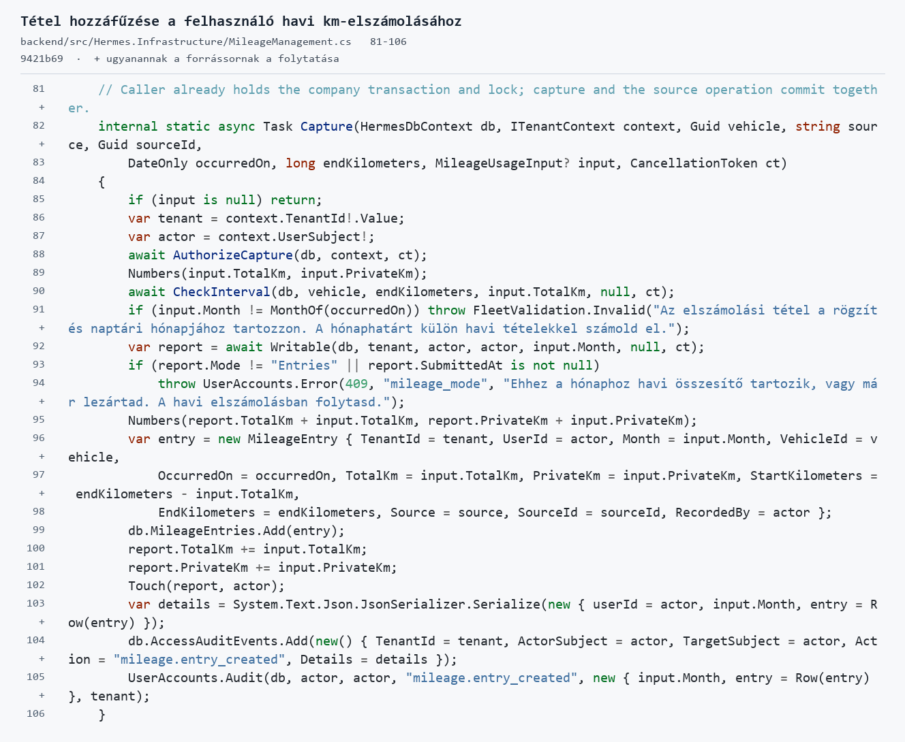

# Tétel hozzáfűzése a felhasználó havi km-elszámolásához



**Forrás** [backend/src/Hermes.Infrastructure/MileageManagement.cs, 81–106. sor](https://github.com/NemodaMark/Hermes_flotter/blob/9421b69278601c8b7e73d032f88858dbc0bb4f2e/backend/src/Hermes.Infrastructure/MileageManagement.cs#L81-L106). **Azonosító** `MileageLedger.Capture`. **Javasolt fejezet** Személyes kilométer-nyilvántartás.

**Működés.** A metódus a szerveroldali kontextusból veszi a céget és a rögzítő személyét, az eseményből a járművet, forrást és óraállást. Ellenőrzi az intervallumot és a hónapot, megkeresi az írható havi összesítést, majd hozzáadja a tételt és a naplóbejegyzéseket.

**Kapcsolatok.** A `Writable` személyi kulcsa és az `entry.UserId = actor` miatt több autó forrásai is ugyanarra a felhasználói hónapra könyvelhetők. A `FleetManagement.RecordFuel` és az óraállásrögzítés hívja a metódust.

**Korlát.** A metódus a hívó tranzakciójában fut. Lezárt hónapra, havi összesítős módra és átfedő intervallumra külön üzleti szabály érvényes.

**Kivágás.** A teljes metódus a hozzá tartozó megjegyzéssel. Az ellenőrző metódusok külön vannak. A képen a `+` vizuális sortörést jelöl ugyanazon forrássoron belül.

```csharp
    // Caller already holds the company transaction and lock; capture and the source operation commit together.
    internal static async Task Capture(HermesDbContext db, ITenantContext context, Guid vehicle, string source, Guid sourceId,
        DateOnly occurredOn, long endKilometers, MileageUsageInput? input, CancellationToken ct)
    {
        if (input is null) return;
        var tenant = context.TenantId!.Value;
        var actor = context.UserSubject!;
        await AuthorizeCapture(db, context, ct);
        Numbers(input.TotalKm, input.PrivateKm);
        await CheckInterval(db, vehicle, endKilometers, input.TotalKm, null, ct);
        if (input.Month != MonthOf(occurredOn)) throw FleetValidation.Invalid("Az elszámolási tétel a rögzítés naptári hónapjához tartozzon. A hónaphatárt külön havi tételekkel számold el.");
        var report = await Writable(db, tenant, actor, actor, input.Month, null, ct);
        if (report.Mode != "Entries" || report.SubmittedAt is not null)
            throw UserAccounts.Error(409, "mileage_mode", "Ehhez a hónaphoz havi összesítő tartozik, vagy már lezártad. A havi elszámolásban folytasd.");
        Numbers(report.TotalKm + input.TotalKm, report.PrivateKm + input.PrivateKm);
        var entry = new MileageEntry { TenantId = tenant, UserId = actor, Month = input.Month, VehicleId = vehicle,
            OccurredOn = occurredOn, TotalKm = input.TotalKm, PrivateKm = input.PrivateKm, StartKilometers = endKilometers - input.TotalKm,
            EndKilometers = endKilometers, Source = source, SourceId = sourceId, RecordedBy = actor };
        db.MileageEntries.Add(entry);
        report.TotalKm += input.TotalKm;
        report.PrivateKm += input.PrivateKm;
        Touch(report, actor);
        var details = System.Text.Json.JsonSerializer.Serialize(new { userId = actor, input.Month, entry = Row(entry) });
        db.AccessAuditEvents.Add(new() { TenantId = tenant, ActorSubject = actor, TargetSubject = actor, Action = "mileage.entry_created", Details = details });
        UserAccounts.Audit(db, actor, actor, "mileage.entry_created", new { input.Month, entry = Row(entry) }, tenant);
    }
```

**A másolható részlet SHA-256 lenyomata** `c05733a4edafc92dbc3ae8a08ce19aa990d25334e8f7cc9c78b25f7d9c3100e8` (UTF-8, LF).
