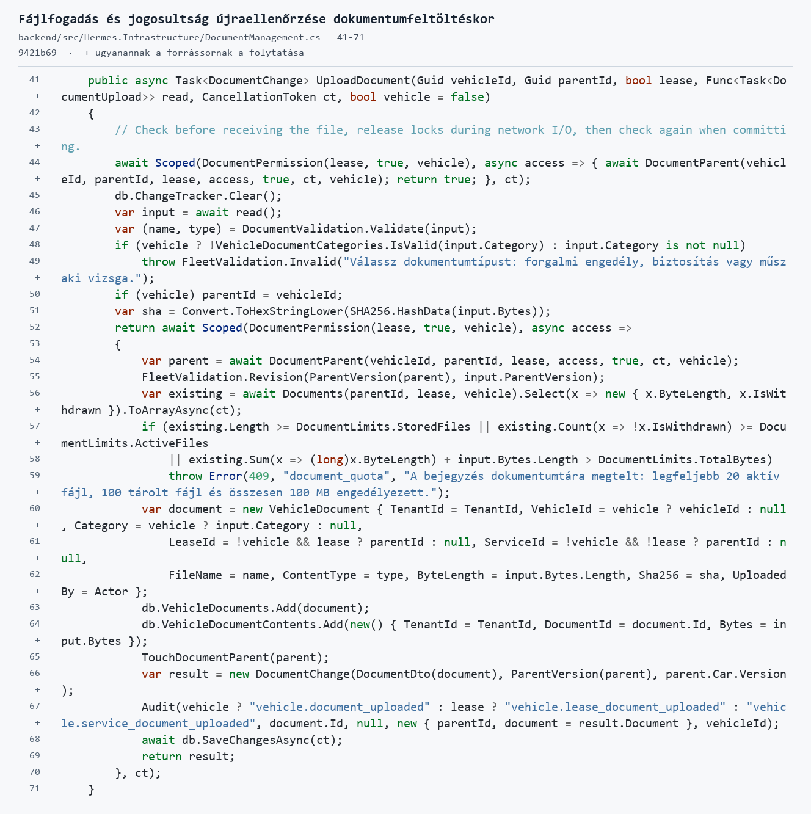

# Fájlfogadás és jogosultság újraellenőrzése dokumentumfeltöltéskor



**Forrás** [backend/src/Hermes.Infrastructure/DocumentManagement.cs, 41–71. sor](https://github.com/NemodaMark/Hermes_flotter/blob/9421b69278601c8b7e73d032f88858dbc0bb4f2e/backend/src/Hermes.Infrastructure/DocumentManagement.cs#L41-L71). **Azonosító** `FleetManagement.UploadDocument`. **Javasolt fejezet** Szerviz és okmánykezelés.

**Működés.** Jármű- és szülőazonosítóval, a dokumentumtípus kapcsolóival és egy aszinkron fájlolvasóval indul. Két céges ellenőrzés között olvassa és validálja a fájlt, majd ellenőrzi a verziót és kvótát, és eltárolja a metaadatot, a bájtokat és az auditot. A visszatérő `DocumentChange` tartalmazza az új verziókat.

**Kapcsolatok.** A fájlolvasás elkülönül a céges zárolástól. A második `DocumentParent` ellenőrzés a mentés pillanatában érvényes állapotot és jogosultságot használja. Az SHA-256 érték a tárolt bájtokból készül.

**Korlát.** Közvetlen járműokmánynál kötött a kategória. A darabszám- és összméretkorlát szülőnként érvényes. A feltöltés külön tárolt metaadatot és tartalmat hoz létre.

**Kivágás.** A teljes metódus. A fájlformátum ellenőrzése és a visszaállítás más metódusban van. A képen a `+` vizuális sortörést jelöl ugyanazon forrássoron belül.

```csharp
    public async Task<DocumentChange> UploadDocument(Guid vehicleId, Guid parentId, bool lease, Func<Task<DocumentUpload>> read, CancellationToken ct, bool vehicle = false)
    {
        // Check before receiving the file, release locks during network I/O, then check again when committing.
        await Scoped(DocumentPermission(lease, true, vehicle), async access => { await DocumentParent(vehicleId, parentId, lease, access, true, ct, vehicle); return true; }, ct);
        db.ChangeTracker.Clear();
        var input = await read();
        var (name, type) = DocumentValidation.Validate(input);
        if (vehicle ? !VehicleDocumentCategories.IsValid(input.Category) : input.Category is not null)
            throw FleetValidation.Invalid("Válassz dokumentumtípust: forgalmi engedély, biztosítás vagy műszaki vizsga.");
        if (vehicle) parentId = vehicleId;
        var sha = Convert.ToHexStringLower(SHA256.HashData(input.Bytes));
        return await Scoped(DocumentPermission(lease, true, vehicle), async access =>
        {
            var parent = await DocumentParent(vehicleId, parentId, lease, access, true, ct, vehicle);
            FleetValidation.Revision(ParentVersion(parent), input.ParentVersion);
            var existing = await Documents(parentId, lease, vehicle).Select(x => new { x.ByteLength, x.IsWithdrawn }).ToArrayAsync(ct);
            if (existing.Length >= DocumentLimits.StoredFiles || existing.Count(x => !x.IsWithdrawn) >= DocumentLimits.ActiveFiles
                || existing.Sum(x => (long)x.ByteLength) + input.Bytes.Length > DocumentLimits.TotalBytes)
                throw Error(409, "document_quota", "A bejegyzés dokumentumtára megtelt: legfeljebb 20 aktív fájl, 100 tárolt fájl és összesen 100 MB engedélyezett.");
            var document = new VehicleDocument { TenantId = TenantId, VehicleId = vehicle ? vehicleId : null, Category = vehicle ? input.Category : null,
                LeaseId = !vehicle && lease ? parentId : null, ServiceId = !vehicle && !lease ? parentId : null,
                FileName = name, ContentType = type, ByteLength = input.Bytes.Length, Sha256 = sha, UploadedBy = Actor };
            db.VehicleDocuments.Add(document);
            db.VehicleDocumentContents.Add(new() { TenantId = TenantId, DocumentId = document.Id, Bytes = input.Bytes });
            TouchDocumentParent(parent);
            var result = new DocumentChange(DocumentDto(document), ParentVersion(parent), parent.Car.Version);
            Audit(vehicle ? "vehicle.document_uploaded" : lease ? "vehicle.lease_document_uploaded" : "vehicle.service_document_uploaded", document.Id, null, new { parentId, document = result.Document }, vehicleId);
            await db.SaveChangesAsync(ct);
            return result;
        }, ct);
    }
```

**A másolható részlet SHA-256 lenyomata** `0d3604b55c35a1469a67086c28a04aac517e904218aeadb0fe3c61d38cd71058` (UTF-8, LF).
