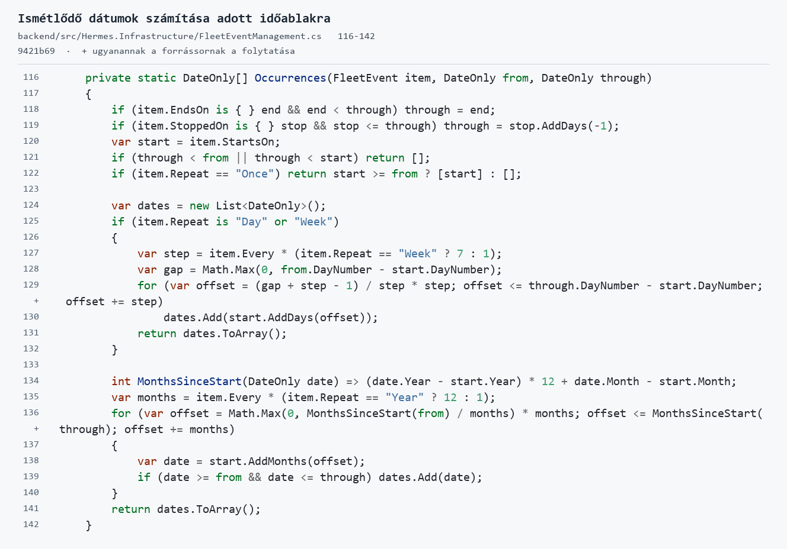

# Ismétlődő dátumok számítása adott időablakra



**Forrás** [backend/src/Hermes.Infrastructure/FleetEventManagement.cs, 116–142. sor](https://github.com/NemodaMark/Hermes_flotter/blob/9421b69278601c8b7e73d032f88858dbc0bb4f2e/backend/src/Hermes.Infrastructure/FleetEventManagement.cs#L116-L142). **Azonosító** `FleetManagement.Occurrences`. **Javasolt fejezet** Flottaesemények.

**Működés.** A bemenet egy ismétlődési szabály és a dátumablak. A metódus leszűkíti az ablakot a végdátum és a leállítás alapján. Napnál és hétnél az első lehetséges eltérésre ugrik, hónapnál és évnél az eredeti kezdőnapból `AddMonths`-szal számol. A kimenet a látható dátumok tömbje.

**Kapcsolatok.** A `FleetEvents` lekérdezés a számított dátumokkal adja vissza a szabályt a havi listához. A hónap végi rövidülésnél az alapdátum változatlan, ezért a következő hosszabb hónapban visszaállhat az eredeti nap.

**Korlát.** A metódus dátumokat szolgáltat a listához. E-mail és háttérben végrehajtott feladat nincs ebben az útvonalban. Az ismétlési intervallum validálását a mentési művelet végzi.

**Kivágás.** A teljes metódus. A képen a `+` vizuális sortörést jelöl ugyanazon forrássoron belül.

```csharp
    private static DateOnly[] Occurrences(FleetEvent item, DateOnly from, DateOnly through)
    {
        if (item.EndsOn is { } end && end < through) through = end;
        if (item.StoppedOn is { } stop && stop <= through) through = stop.AddDays(-1);
        var start = item.StartsOn;
        if (through < from || through < start) return [];
        if (item.Repeat == "Once") return start >= from ? [start] : [];

        var dates = new List<DateOnly>();
        if (item.Repeat is "Day" or "Week")
        {
            var step = item.Every * (item.Repeat == "Week" ? 7 : 1);
            var gap = Math.Max(0, from.DayNumber - start.DayNumber);
            for (var offset = (gap + step - 1) / step * step; offset <= through.DayNumber - start.DayNumber; offset += step)
                dates.Add(start.AddDays(offset));
            return dates.ToArray();
        }

        int MonthsSinceStart(DateOnly date) => (date.Year - start.Year) * 12 + date.Month - start.Month;
        var months = item.Every * (item.Repeat == "Year" ? 12 : 1);
        for (var offset = Math.Max(0, MonthsSinceStart(from) / months) * months; offset <= MonthsSinceStart(through); offset += months)
        {
            var date = start.AddMonths(offset);
            if (date >= from && date <= through) dates.Add(date);
        }
        return dates.ToArray();
    }
```

**A másolható részlet SHA-256 lenyomata** `28c88a4f3fa53fd56379dfb8b14ea7edca1ca2d609e606247e135cd69bc74eb8` (UTF-8, LF).
