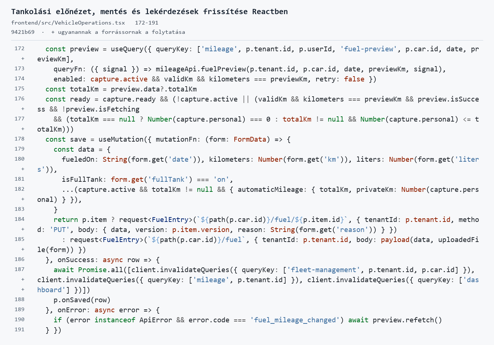

# Tankolási előnézet, mentés és lekérdezések frissítése Reactben



**Forrás** [frontend/src/VehicleOperations.tsx, 172–191. sor](https://github.com/NemodaMark/Hermes_flotter/blob/9421b69278601c8b7e73d032f88858dbc0bb4f2e/frontend/src/VehicleOperations.tsx#L172-L191). **Azonosító** `VehicleFuelForm, az előnézet és a `save` mutáció`. **Javasolt fejezet** Webes kliens és validáció.

**Működés.** A cég, aktor, jármű, dátum és a késleltetve követett óraállás alkotja a lekérdezési kulcsot. Érvényes bemenetnél kér előnézetet. Mentéskor a `FormData` mezőiből állítja össze az API-bemenetet, érvényesíti az érintett gyorsítótárakat és jelzi a sikert a szülőnek.

**Kapcsolatok.** A `ready` állapot a privát km-t a kiszámolt távolsághoz méri. Ha a backend változott távolságot jelez, a kliens új előnézetet kér. Az új tétel és a javítás végpontja és bemenete különbözik.

**Korlát.** A szerver az irányadó a távolság és a jogosultság kérdésében. Az `enabled` csak az előnézet indítását vezérli. A kezdeti állapot és az űrlap a kivágáson kívül található.

**Kivágás.** Összefüggő belső blokk. A komponens eleje és JSX-visszatérése kimarad. A képen a `+` vizuális sortörést jelöl ugyanazon forrássoron belül.

```tsx
  const preview = useQuery({ queryKey: ['mileage', p.tenant.id, p.userId, 'fuel-preview', p.car.id, date, previewKm],
    queryFn: ({ signal }) => mileageApi.fuelPreview(p.tenant.id, p.car.id, date, previewKm, signal),
    enabled: capture.active && validKm && kilometers === previewKm, retry: false })
  const totalKm = preview.data?.totalKm
  const ready = capture.ready && (!capture.active || (validKm && kilometers === previewKm && preview.isSuccess && !preview.isFetching
    && (totalKm === null ? Number(capture.personal) === 0 : totalKm != null && Number(capture.personal) <= totalKm)))
  const save = useMutation({ mutationFn: (form: FormData) => {
    const data = {
      fueledOn: String(form.get('date')), kilometers: Number(form.get('km')), liters: Number(form.get('liters')),
      isFullTank: form.get('fullTank') === 'on',
      ...(capture.active && totalKm != null && { automaticMileage: { totalKm, privateKm: Number(capture.personal) } }),
    }
    return p.item ? request<FuelEntry>(`${path(p.car.id)}/fuel/${p.item.id}`, { tenantId: p.tenant.id, method: 'PUT', body: { data, version: p.item.version, reason: String(form.get('reason')) } })
      : request<FuelEntry>(`${path(p.car.id)}/fuel`, { tenantId: p.tenant.id, body: payload(data, uploadedFile(form)) })
  }, onSuccess: async row => {
    await Promise.all([client.invalidateQueries({ queryKey: ['fleet-management', p.tenant.id, p.car.id] }), client.invalidateQueries({ queryKey: ['mileage', p.tenant.id] }), client.invalidateQueries({ queryKey: ['dashboard'] })])
    p.onSaved(row)
  }, onError: async error => {
    if (error instanceof ApiError && error.code === 'fuel_mileage_changed') await preview.refetch()
  } })
```

**A másolható részlet SHA-256 lenyomata** `2ffd0005e730170702eeac79288c4e60b9aa8e019bd7e8f30bc223784ba8866f` (UTF-8, LF).
