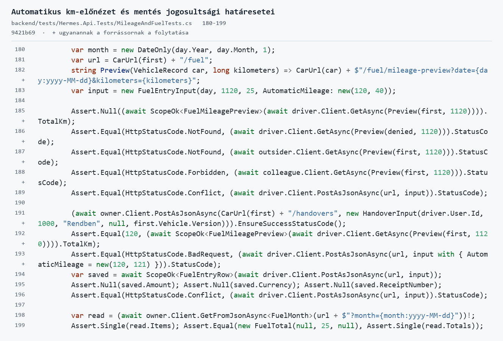

# Automatikus km-előnézet és mentés jogosultsági határesetei



**Forrás** [backend/tests/Hermes.Api.Tests/MileageAndFuelTests.cs, 180–199. sor](https://github.com/NemodaMark/Hermes_flotter/blob/9421b69278601c8b7e73d032f88858dbc0bb4f2e/backend/tests/Hermes.Api.Tests/MileageAndFuelTests.cs#L180-L199). **Azonosító** `MileageAndFuelTests.Fuel_preview_and_save_calculate_personal_mileage_across_vehicles_and_respect_handover_and_scope`. **Javasolt fejezet** Automatizált ellenőrzések.

**Működés.** A teszt fiktív szereplőkkel és autókkal HTTP-kéréseket küld. Átadás előtt nincs elszámolható táv. Idegen autó vagy cég 404-et, a hiányzó saját km-jog 403-at ad. Átadás után az előnézet 120 km. A túl sok magán-km 400-at, a már nem egyező táv 409-et eredményez. A listában pontosan egy érvényes tétel marad.

**Kapcsolatok.** A részlet az API-t és az adatbázist együtt ellenőrzi a `FleetFixture` környezetében. A teszt későbbi, a képen kívüli része egy második jármű elszámolását és a személyszintű havi összesítést is ellenőrzi.

**Korlát.** A forgatókönyv HTTP-integrációs próba. Felületi megjelenítést a böngészős ellenőrzés vizsgál.

**Kivágás.** Összefüggő metódusrészlet. A fixture előkészítése és a második jármű ellenőrzése kimarad. A képen a `+` vizuális sortörést jelöl ugyanazon forrássoron belül.

```csharp
        var month = new DateOnly(day.Year, day.Month, 1);
        var url = CarUrl(first) + "/fuel";
        string Preview(VehicleRecord car, long kilometers) => CarUrl(car) + $"/fuel/mileage-preview?date={day:yyyy-MM-dd}&kilometers={kilometers}";
        var input = new FuelEntryInput(day, 1120, 25, AutomaticMileage: new(120, 40));

        Assert.Null((await ScopeOk<FuelMileagePreview>(await driver.Client.GetAsync(Preview(first, 1120)))).TotalKm);
        Assert.Equal(HttpStatusCode.NotFound, (await driver.Client.GetAsync(Preview(denied, 1120))).StatusCode);
        Assert.Equal(HttpStatusCode.NotFound, (await outsider.Client.GetAsync(Preview(first, 1120))).StatusCode);
        Assert.Equal(HttpStatusCode.Forbidden, (await colleague.Client.GetAsync(Preview(first, 1120))).StatusCode);
        Assert.Equal(HttpStatusCode.Conflict, (await driver.Client.PostAsJsonAsync(url, input)).StatusCode);

        (await owner.Client.PostAsJsonAsync(CarUrl(first) + "/handovers", new HandoverInput(driver.User.Id, 1000, "Rendben", null, first.Vehicle.Version))).EnsureSuccessStatusCode();
        Assert.Equal(120, (await ScopeOk<FuelMileagePreview>(await driver.Client.GetAsync(Preview(first, 1120)))).TotalKm);
        Assert.Equal(HttpStatusCode.BadRequest, (await driver.Client.PostAsJsonAsync(url, input with { AutomaticMileage = new(120, 121) })).StatusCode);
        var saved = await ScopeOk<FuelEntryRow>(await driver.Client.PostAsJsonAsync(url, input));
        Assert.Null(saved.Amount); Assert.Null(saved.Currency); Assert.Null(saved.ReceiptNumber);
        Assert.Equal(HttpStatusCode.Conflict, (await driver.Client.PostAsJsonAsync(url, input)).StatusCode);

        var read = (await owner.Client.GetFromJsonAsync<FuelMonth>(url + $"?month={month:yyyy-MM-dd}"))!;
        Assert.Single(read.Items); Assert.Equal(new FuelTotal(null, 25, null), Assert.Single(read.Totals));
```

**A másolható részlet SHA-256 lenyomata** `b034f19e245bd3de18532f54a3e1275eb19a0a9b73aff0d77539ccb9ae8f2f5c` (UTF-8, LF).
